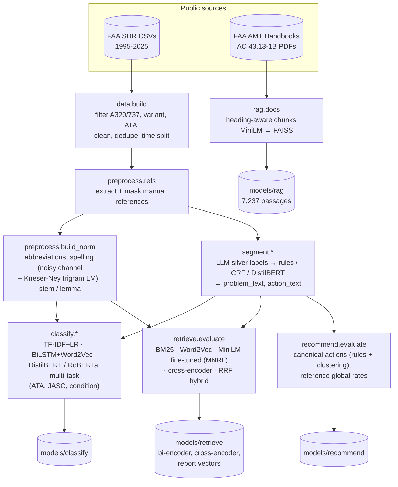
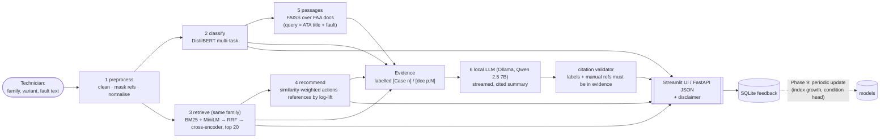

# AeroFix architecture

Two halves: an **offline** pipeline that turns 31 years of FAA reports into models and indexes (each box is one `python -m ...` command), and an **online** request path that the Streamlit app and the FastAPI service share through one `Advisor` object (`src/aerofix/pipeline.py`).

## Offline: data → models

## Online: one request

Steps 1–5 take ~0.1–0.25 s; the LLM summary streams in and completes in ~5 s on an RTX 4060 laptop GPU.

## Key design decisions (details in VIVA_NOTES.md)

| Decision | Why |
|---|---|
| Time-based split (≤2023 / 2024 / 2025) and cross-year dedup | The deployed system always predicts the future; random splits leak near-duplicate reports |
| Mask manual references, classify the *problem* text | References contain the ATA chapter; the action text is unknown when the fault is reported |
| Retrieval, not classification, drives recommendations | Similar cases carry the specific part and fix; a chapter label does not |
| Hybrid retrieval + reranking | BM25 catches exact part names; dense vectors catch paraphrases and typos |
| LLM sees only labelled evidence; output is validated | Keeps the summary grounded and auditable; no OEM procedures are generated |
| One `Advisor` for UI and API | No duplicated logic; models load once |
