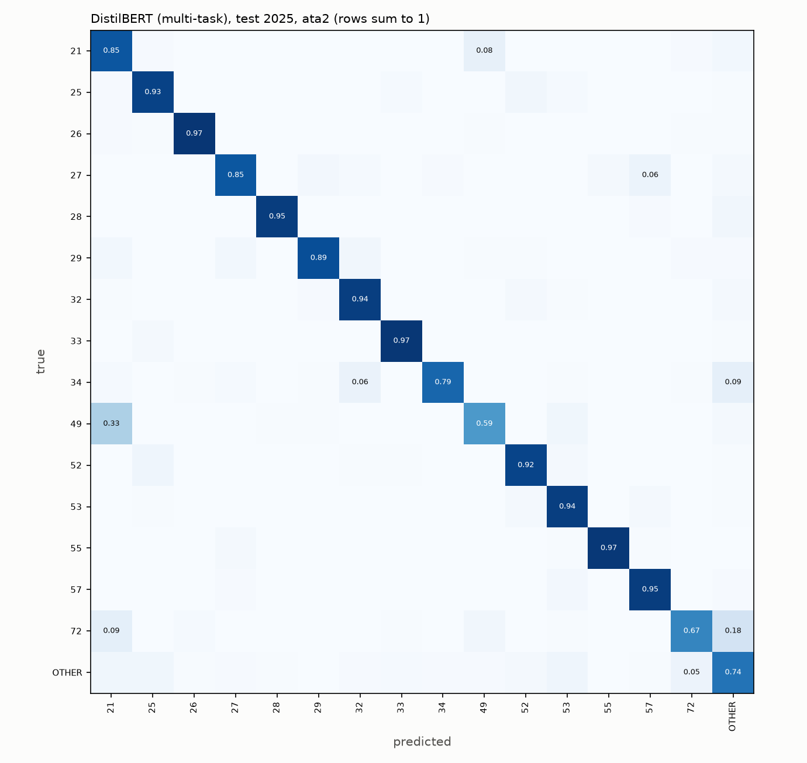
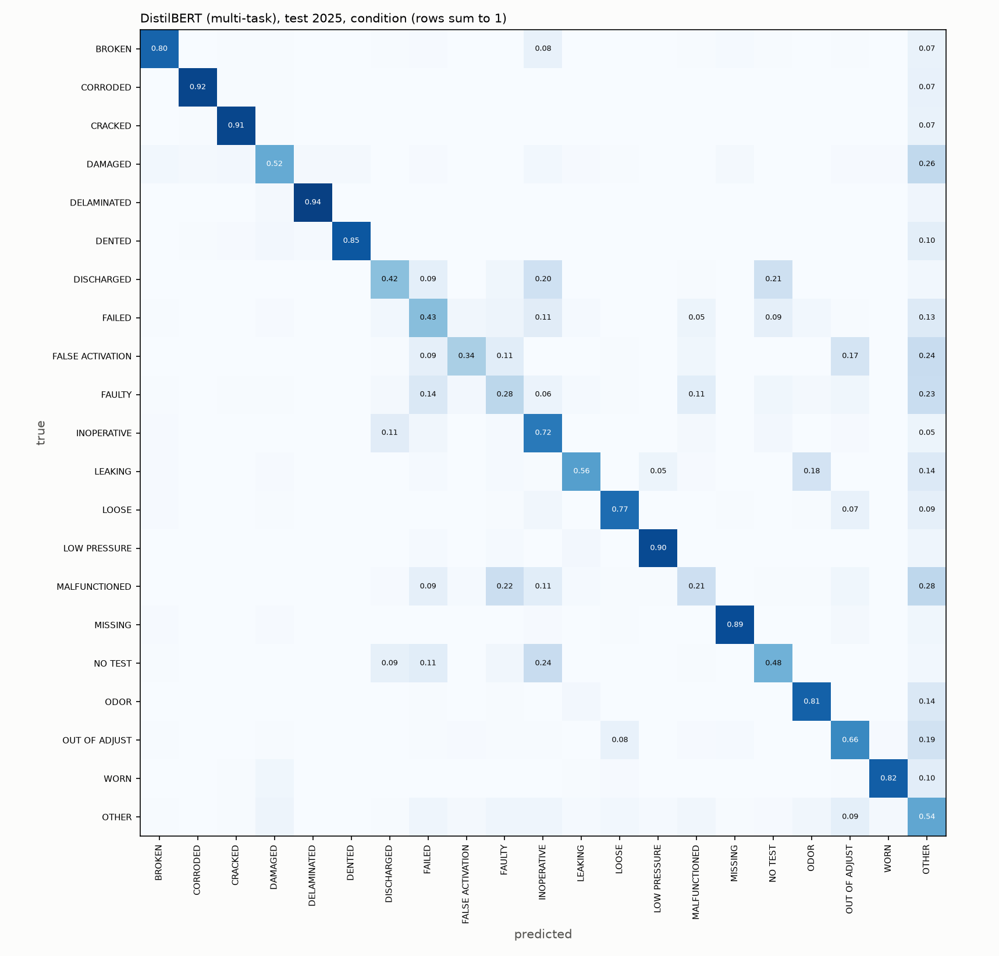

# Classification (Phase 4)
Generated by `python -m aerofix.classify.report`. Input: `problem_masked` (Phase 3 problem text, references masked) unless stated. Model choices use **val (2024)**; **test (2025)** is scored once with frozen models. Headline metric: macro-F1 (every class counts equally).
## 1. Targets

Classes are chosen from train counts. `share_OTHER` shows how much of each split falls outside the label space; a jump from train to test means the label vocabulary drifted.

| target | split | classes | share_OTHER_% |
|---|---|---|---|
| ata2 | train | 16 | 6.4 |
| ata2 | val | 16 | 4.9 |
| ata2 | test | 16 | 5.3 |
| ata4 | train | 226 | 1.5 |
| ata4 | val | 226 | 1.3 |
| ata4 | test | 226 | 1.4 |
| condition | train | 21 | 15.0 |
| condition | val | 21 | 20.9 |
| condition | test | 21 | 24.4 |
## 2a. Results on val (2024)

| model | ata2_macro_F1 | ata2_accuracy | ata2_top3_acc | ata4_macro_F1 | ata4_accuracy | ata4_top3_acc | condition_macro_F1 | condition_accuracy | condition_top3_acc |
|---|---|---|---|---|---|---|---|---|---|
| DistilBERT (multi-task) | 0.8475 | 0.8978 | 0.9888 | 0.3923 | 0.6748 | 0.8915 | 0.6047 | 0.7203 | 0.939 |
| RoBERTa-base (multi-task) | 0.8444 | 0.8966 | 0.9893 | 0.3897 | 0.6804 | 0.8941 | 0.5987 | 0.7093 | 0.9361 |
| BiLSTM + Word2Vec | 0.8402 | 0.893 | 0.9879 | 0.35 | 0.6779 | 0.8845 | 0.5859 | 0.6995 | 0.9226 |
| TF-IDF + LR | 0.822 | 0.8701 | 0.9796 | 0.3772 | 0.6724 | 0.8629 | 0.5853 | 0.7017 | 0.9171 |
| Majority class | 0.0361 | 0.4062 | 0.4481 | 0.0014 | 0.1906 | 0.2107 | 0.0166 | 0.2115 | 0.4277 |
## 2b. Results on test (2025, frozen models)

| model | ata2_macro_F1 | ata2_accuracy | ata2_top3_acc | ata4_macro_F1 | ata4_accuracy | ata4_top3_acc | condition_macro_F1 | condition_accuracy | condition_top3_acc |
|---|---|---|---|---|---|---|---|---|---|
| RoBERTa-base (multi-task) | 0.8597 | 0.9216 | 0.9888 | 0.4034 | 0.7146 | 0.8974 | 0.6039 | 0.7101 | 0.9288 |
| DistilBERT (multi-task) | 0.8588 | 0.9215 | 0.9892 | 0.3929 | 0.7143 | 0.8992 | 0.6104 | 0.7271 | 0.9309 |
| BiLSTM + Word2Vec | 0.8467 | 0.9133 | 0.9867 | 0.3659 | 0.6972 | 0.8839 | 0.5827 | 0.6884 | 0.9155 |
| TF-IDF + LR | 0.8196 | 0.8916 | 0.9793 | 0.3712 | 0.6882 | 0.8728 | 0.5827 | 0.6833 | 0.9045 |
| Majority class | 0.0321 | 0.3457 | 0.3921 | 0.0012 | 0.1497 | 0.1753 | 0.0151 | 0.1886 | 0.3822 |

**Best on val ata2 macro-F1: DistilBERT (multi-task)** (used for the per-class tables, confusion matrices and error analysis below, and by the app).

## 3. DistilBERT (multi-task): per-class F1 on test, ata2

| class | precision | recall | F1 | support |
|---|---|---|---|---|
| 53 | 0.977 | 0.941 | 0.959 | 11507 |
| 33 | 0.982 | 0.969 | 0.976 | 5725 |
| 25 | 0.903 | 0.926 | 0.914 | 3996 |
| 52 | 0.866 | 0.919 | 0.892 | 3189 |
| 57 | 0.879 | 0.948 | 0.912 | 1879 |
| OTHER | 0.809 | 0.739 | 0.773 | 1764 |
| 55 | 0.97 | 0.968 | 0.969 | 1440 |
| 21 | 0.798 | 0.854 | 0.825 | 1304 |
| 32 | 0.841 | 0.944 | 0.889 | 447 |
| 72 | 0.695 | 0.67 | 0.682 | 397 |
| 27 | 0.805 | 0.851 | 0.827 | 368 |
| 28 | 0.941 | 0.947 | 0.944 | 339 |
| 49 | 0.557 | 0.593 | 0.574 | 307 |
| 29 | 0.889 | 0.885 | 0.887 | 244 |
| 26 | 0.882 | 0.975 | 0.926 | 238 |
| 34 | 0.791 | 0.791 | 0.791 | 139 |

## 3. DistilBERT (multi-task): per-class F1 on test, condition

| class | precision | recall | F1 | support |
|---|---|---|---|---|
| OTHER | 0.663 | 0.535 | 0.592 | 8110 |
| CRACKED | 0.977 | 0.913 | 0.944 | 6276 |
| CORRODED | 0.986 | 0.917 | 0.95 | 5702 |
| INOPERATIVE | 0.673 | 0.717 | 0.694 | 2789 |
| NO TEST | 0.747 | 0.484 | 0.588 | 1451 |
| DAMAGED | 0.545 | 0.519 | 0.532 | 1239 |
| ODOR | 0.693 | 0.811 | 0.747 | 1045 |
| LOOSE | 0.691 | 0.766 | 0.727 | 915 |
| BROKEN | 0.778 | 0.798 | 0.788 | 742 |
| OUT OF ADJUST | 0.338 | 0.658 | 0.446 | 707 |
| FAILED | 0.277 | 0.43 | 0.337 | 647 |
| MISSING | 0.838 | 0.891 | 0.863 | 603 |
| LOW PRESSURE | 0.806 | 0.898 | 0.849 | 596 |
| DELAMINATED | 0.907 | 0.936 | 0.921 | 575 |
| WORN | 0.674 | 0.823 | 0.741 | 487 |
| LEAKING | 0.592 | 0.564 | 0.577 | 463 |
| DENTED | 0.767 | 0.85 | 0.806 | 213 |
| MALFUNCTIONED | 0.098 | 0.211 | 0.134 | 213 |
| FAULTY | 0.081 | 0.278 | 0.126 | 194 |
| FALSE ACTIVATION | 0.262 | 0.339 | 0.295 | 183 |
| DISCHARGED | 0.098 | 0.421 | 0.159 | 133 |

## 4. Ablations with TF-IDF + LR (ata2, val)

All variants use the same fixed train sample size, so differences come from the input, not the amount of data. Character n-grams are taken from tokenised text (see 4b for why).

| experiment | eval_on | train_rows | macro_F1 | accuracy | top3_acc |
|---|---|---|---|---|---|
| leakage: full report, UNMASKED | val | 150000 | 0.8366 | 0.8756 | 0.9848 |
| leakage: full report, masked | val | 150000 | 0.8273 | 0.8699 | 0.9831 |
| leakage: problem only, unmasked | val | 150000 | 0.7913 | 0.849 | 0.9678 |
| leakage: problem only, masked | val | 150000 | 0.81 | 0.8661 | 0.978 |
| norm: tokenised only (control) | val | 150000 | 0.81 | 0.8661 | 0.978 |
| norm: + abbrev + spelling | val | 150000 | 0.8118 | 0.8692 | 0.9779 |
| norm: + Porter stem | val | 150000 | 0.811 | 0.8714 | 0.9807 |
| norm: + WordNet lemma | val | 150000 | 0.8065 | 0.8673 | 0.9787 |
| years: 2015-2023 only | val | 150000 | 0.8174 | 0.8766 | 0.9828 |
| family: train A320 only | val A320 | 118155 | 0.8288 | 0.8304 | 0.98 |
| family: train A320 only | val B737 | 118155 | 0.7522 | 0.8904 | 0.9732 |
| family: train B737 only | val A320 | 118155 | 0.7228 | 0.7238 | 0.9451 |
| family: train B737 only | val B737 | 118155 | 0.8093 | 0.8927 | 0.9821 |

### 4b. Why character n-grams use tokenised text

Earlier run with character n-grams on the *raw* problem text. Normalised inputs looked +2 points better, but the 'tokenised only' control shows almost all of that gain comes from dropping punctuation before the character n-grams, not from abbreviation expansion or spelling correction. The final pipeline therefore tokenises first.

| experiment | macro_F1 | accuracy |
|---|---|---|
| leakage: problem only, masked | 0.7915 | 0.8568 |
| norm: tokenised only (control) | 0.81 | 0.8661 |
| norm: + abbrev + spelling | 0.8118 | 0.8692 |
| norm: + Porter stem | 0.811 | 0.8714 |
| norm: + WordNet lemma | 0.8065 | 0.8673 |

## 5. Leakage ablation with DistilBERT (equal budget: 1 epoch each)

| DistilBERT input | val ata2 macro-F1 after 1 epoch | val ata2 accuracy after 1 epoch |
|---|---|---|
| full report, UNMASKED | 0.8848 | 0.9116 |
| full report, masked | 0.8761 | 0.908 |
| problem only, masked (main model) | 0.8417 | 0.8893 |

## 6. Cross-family transfer with DistilBERT (ata2, val; equal train size per family)

| train on | eval on val | accuracy | macro_F1 | weighted_F1 | top3_acc |
|---|---|---|---|---|---|
| A320 | A320 | 0.8386 | 0.8297 | 0.8386 | 0.9812 |
| A320 | B737 | 0.9008 | 0.782 | 0.9035 | 0.9747 |
| B737 | A320 | 0.7882 | 0.7613 | 0.7935 | 0.956 |
| B737 | B737 | 0.92 | 0.8301 | 0.9215 | 0.985 |

### Training history: BiLSTM + Word2Vec

| epoch | train_loss | minutes | val_ata2_macro_F1 | val_ata4_macro_F1 | val_condition_macro_F1 | val_ata2_acc |
|---|---|---|---|---|---|---|
| 1 | 3.2645 | 0.9 | 0.8318 | 0.3253 | 0.5859 | 0.8922 |
| 2 | 2.3005 | 0.9 | 0.8313 | 0.3383 | 0.5869 | 0.8882 |
| 3 | 2.0961 | 0.9 | 0.8402 | 0.35 | 0.5859 | 0.893 |
| 4 | 1.963 | 0.9 | 0.8373 | 0.3662 | 0.5912 | 0.8919 |
| 5 | 1.8518 | 0.9 | 0.8357 | 0.3788 | 0.5888 | 0.8887 |

### Training history: DistilBERT (multi-task)

| epoch | train_loss | minutes | val_ata2_macro_F1 | val_ata4_macro_F1 | val_condition_macro_F1 | val_ata2_acc |
|---|---|---|---|---|---|---|
| 1 | 3.5587 | 8.3 | 0.8417 | 0.3533 | 0.5891 | 0.8893 |
| 2 | 2.0694 | 8.3 | 0.8421 | 0.3933 | 0.6073 | 0.8958 |
| 3 | 1.798 | 8.3 | 0.8463 | 0.3959 | 0.603 | 0.8964 |
| 4 | 1.6197 | 8.2 | 0.8475 | 0.3923 | 0.6047 | 0.8978 |

### Training history: RoBERTa-base (multi-task)

| epoch | train_loss | minutes | val_ata2_macro_F1 | val_ata4_macro_F1 | val_condition_macro_F1 | val_ata2_acc |
|---|---|---|---|---|---|---|
| 1 | 3.3911 | 16.3 | 0.8398 | 0.3471 | 0.6004 | 0.8903 |
| 2 | 2.1223 | 15.3 | 0.8421 | 0.3771 | 0.5966 | 0.891 |
| 3 | 1.8618 | 15.3 | 0.8444 | 0.3897 | 0.5987 | 0.8966 |

## 8. Error sample (DistilBERT (multi-task), test, ata2, 20 random mistakes)

| problem text | true | predicted | confidence |
|---|---|---|---|
| R3 DOOR ARMING LEVER LOOSE. | 52 | 25 | 0.52 |
| SEVERAL CRACK INDICATIONS FOUND ON BOTH FRAME SEGMENTS 1 OF THE FWD LH SIDE OVERWING EMERGENCY EXIT HATCH DOOR | 53 | 52 | 0.81 |
| FUME EVENT ON TAKEOFF PACK 1-REF LP-6019368-2, OIL LEAK ON APU GENERATOR FOUND AND COORECTED AND PERFORMED DEC | 21 | 49 | 0.59 |
| CRACK EMERGENCY EXIT DOOR 844 LH LOAD TRANSMITTING PROFILE IN PASSENGER CABIN MEASURE CRACK IS L = 0.588 INCH. | 53 | 52 | 0.85 |
| APU DROPPED OFF LINE PUT THE GENERATORS OFF, BACK ON, THE APU BUSS STRONG SMOKE ODOR. FOUND TERMINAL LUGS FOR  | OTHER | 49 | 0.62 |
| AT CRUISE, FLIGHT ATTADNENT REPORTED BURNING SMELL AFTER GALLEY. CAPTAIN VERIFIED VERY STRONG ELECTRICAL BURNI | 25 | 21 | 0.78 |
| IN PREPARATION TO REMOVE DOOR LINER PULLED AND COLLARD CBS P91 D7 AND D9 REF [REF] CLOSED CBS AND SHUT EANDE D | OTHER | 52 | 0.90 |
| AFT ENTRY DOOR FORWARD SLIDE MOUNT CRACKED. | 52 | 25 | 0.50 |
| DOOR ASSIST STRAP PANEL NOT SECURE ON FWD L/H OVERWING EXIT NOT SECURE < [01] RESECURED DOOR ASSIST STRAP PLAT | 52 | 25 | 0.54 |
| FWD | 53 | 25 | 0.53 |
| AFTER 50, 000 TOTAL AIRPLANE CYCLES, PERFORM EXTERNAL DETAILED VISUAL (DET) IN SPECTIONS AT 4, 000 FLIGHT CYCL | 53 | 34 | 0.41 |
| (A204 DOT 60) LEFT EMERGENCY EXIT HATCH ESCAPE STRAP HOOK HAS MINOR CORROSION < [01] LEFT EMERGENCY EXIT HATCH | 52 | 25 | 0.97 |
| LEFT AFTER LAVATORY DOOR HARD TO MOVE. | 53 | 52 | 0.88 |
| BROKEN PHOTOLUMINESCENT STRIP RH SIDE AT PASSENGER CABIN | 33 | 25 | 0.81 |
| ON TAXI OUT BEFORE TAKE OFF THE CREW OF A NEARBY AIRPLANE REPORTED 2-3 FOOT FLAMES COMING OUT OF THE # 1 ENGIN | OTHER | 72 | 0.98 |
| CRACK ANGLE - SUPPORT BETWEEN BS 907 TO BS 927 STRINGER 25R AND STRNGER 27R AFT CARGO COMPARTMENT 2024-780306  | 25 | 53 | 1.00 |
| ON THE R3 WINDOW FRAME E-F POST ACCOMPLISH INSPECTION REQUIREMENTS PER PART 2 OF EC/RA 5311-03375 ON OR BEFORE | OTHER | 53 | 0.85 |
| FOUND CRACK LOWER FUS CTR REAR SPAR R/H VAPOR BARRIER UPPER ATTACHED ANGLE RBL 7 STA 663.75. ACCOMPLISHED STA- | 53 | 57 | 0.56 |
| LEFT WING INTERCONNECT STRUT, FWD ROD BEARING WITH PLAY AND NUT WITH RUST. | 27 | 57 | 0.67 |
| RIGHT HAND MAIN LANDING GEAR DOOR FORWARD HINGE FITTING WORN UNDER ATTACHMNET BOLT HEAD AT FR 42 AND S36R. | 53 | 52 | 0.85 |
