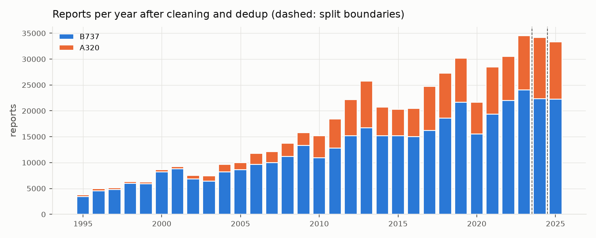
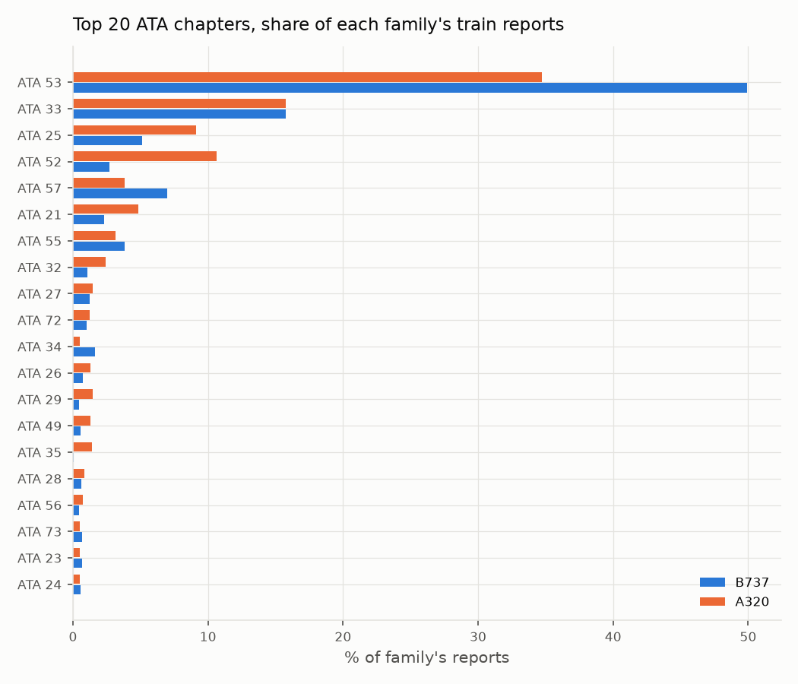
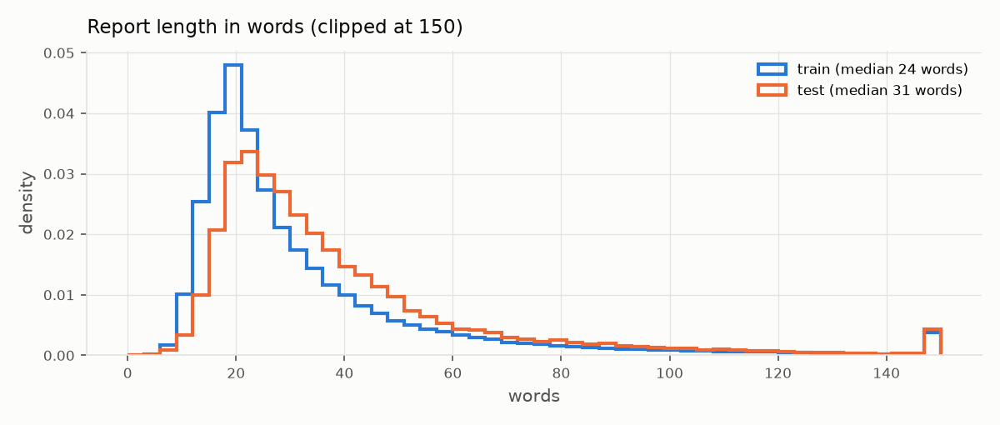
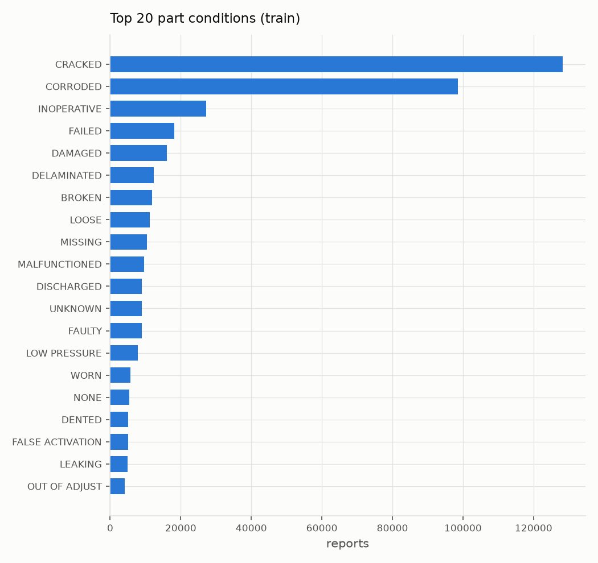
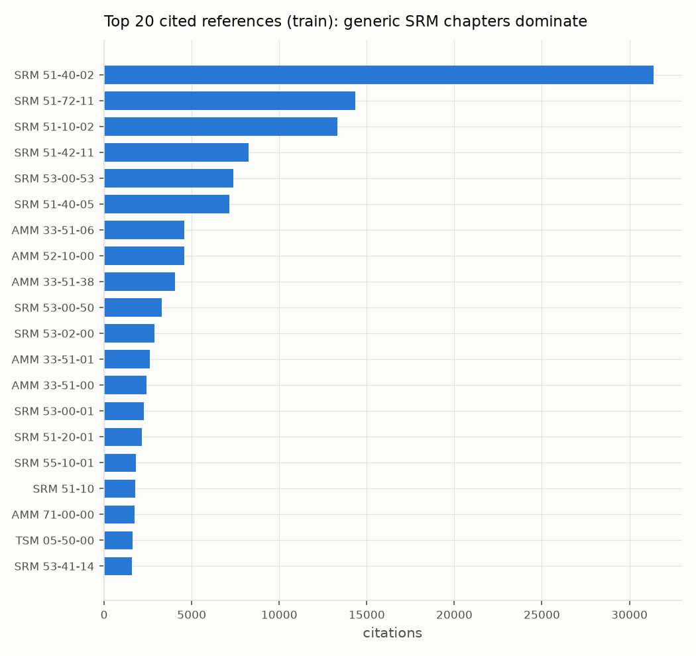
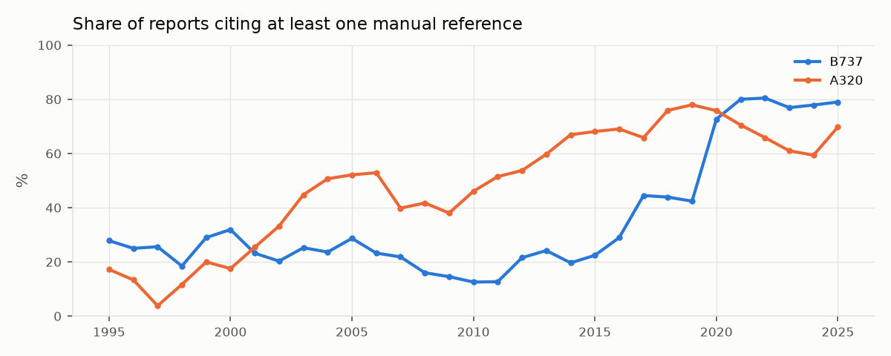

# AeroFix EDA

Generated by `python -m aerofix.eval.eda` from `data/processed/sdr_a320_b737.parquet` (1995-2025, A320 family + 737, after cleaning and deduplication). Design statistics (top-K chapters, abbreviation candidates) use **train only**.

## 1. Size per split and family

| split | A320 | B737 |
|---|---|---|
| train | 118155 | 354392 |
| val | 11818 | 22360 |
| test | 11047 | 22236 |

## 2. Variants

| family | variant | reports |
|---|---|---|
| B737 | 737-700 | 121864 |
| B737 | 737-800 | 94485 |
| B737 | 737-300 | 89383 |
| A320 | A320 | 57573 |
| A320 | A319 | 46680 |
| A320 | A321 | 28485 |
| B737 | 737-200 | 21113 |
| B737 | 737-400 | 20183 |
| B737 | 737-900ER | 17088 |
| B737 | 737 (unspecified) | 12839 |
| B737 | 737-500 | 10715 |
| B737 | 737 MAX 8 | 4705 |
| A320 | A321neo | 4428 |
| B737 | 737-900 | 3149 |
| B737 | 737 MAX 9 | 3104 |
| A320 | A320neo | 2163 |
| A320 | A320 family (unspecified) | 1691 |
| B737 | 737-100 | 344 |
| B737 | 737 MAX 8-200 | 14 |
| B737 | 737-600 | 2 |

By generation:

| family | generation | reports |
|---|---|---|
| A320 | Unspecified | 1691 |
| A320 | ceo | 132738 |
| A320 | neo | 6591 |
| B737 | Classic | 120281 |
| B737 | MAX | 7823 |
| B737 | NG | 236588 |
| B737 | Original | 21457 |
| B737 | Unspecified | 12839 |

## 3. ATA chapters

Train has 43 chapters and 461 JASC codes; 34 chapters have >= 200 train reports. The top 15 cover 93.6% of train; the rest become `OTHER` in Phase 4.

| ata2 | train_reports | share_% | cumulative_% |
|---|---|---|---|
| 53 | 217945 | 46.1 | 46.1 |
| 33 | 74554 | 15.8 | 61.9 |
| 57 | 29188 | 6.2 | 68.1 |
| 25 | 28898 | 6.1 | 74.2 |
| 52 | 22120 | 4.7 | 78.9 |
| 55 | 17389 | 3.7 | 82.6 |
| 21 | 13947 | 3.0 | 85.5 |
| 32 | 6684 | 1.4 | 86.9 |
| 34 | 6341 | 1.3 | 88.3 |
| 27 | 6105 | 1.3 | 89.6 |
| 72 | 5117 | 1.1 | 90.6 |
| 26 | 4047 | 0.9 | 91.5 |
| 49 | 3625 | 0.8 | 92.3 |
| 29 | 3348 | 0.7 | 93.0 |
| 28 | 3129 | 0.7 | 93.6 |
| 73 | 2959 | 0.6 | 94.3 |
| 23 | 2958 | 0.6 | 94.9 |
| 22 | 2802 | 0.6 | 95.5 |
| 24 | 2641 | 0.6 | 96.0 |
| 30 | 2501 | 0.5 | 96.6 |
| 56 | 2468 | 0.5 | 97.1 |
| 54 | 2227 | 0.5 | 97.6 |
| 35 | 1975 | 0.4 | 98.0 |
| 36 | 1657 | 0.4 | 98.3 |
| 75 | 1329 | 0.3 | 98.6 |

2025 (test) top chapters, for comparison with the brief:

| ata2 | test_reports |
|---|---|
| 53 | 11507 |
| 33 | 5725 |
| 25 | 3996 |
| 52 | 3189 |
| 57 | 1879 |
| 55 | 1440 |
| 21 | 1304 |
| 32 | 447 |

## 4. Text length

| split | count | mean | std | min | 25% | 50% | 75% | max |
|---|---|---|---|---|---|---|---|---|
| train | 472547.0 | 32.9 | 27.4 | 3.0 | 18.0 | 24.0 | 37.0 | 1536.0 |
| val | 34178.0 | 43.4 | 33.4 | 3.0 | 22.0 | 33.0 | 52.0 | 485.0 |
| test | 33283.0 | 39.2 | 29.6 | 3.0 | 22.0 | 31.0 | 45.5 | 839.0 |

## 5. Part conditions (train)

## 6. Manual references

Manual types cited (train):

| type | citations |
|---|---|
| SRM | 146353 |
| AMM | 106841 |
| FIM | 10018 |
| REF | 6720 |
| TSM | 4834 |
| CMM | 2399 |
| MEL | 1784 |
| WDM | 1307 |
| IPC | 1070 |
| SWPM | 598 |
| NDT | 543 |
| NDTM | 456 |
| SSM | 122 |

### Label leakage

If the reference chapter equals the ATA label, a model can read the answer off the text. Masking replaces references with `[REF]`. The last column is the share of rows where a short `NN-NN` number matching the label still survives masking (unusual formats such as `SRI 55-26`, `CDL 32-10`, `A321AMM 72-15`).

| split | rows | cite_ref_% | any_ref_chapter_=_ata2_% | first_ref_chapter_=_ata2_% | residual_leak_after_mask_% |
|---|---|---|---|---|---|
| train | 472547 | 44.1 | 62.1 | 57.7 | 0.4 |
| val | 34178 | 71.5 | 58.4 | 54.7 | 0.25 |
| test | 33283 | 75.9 | 64.2 | 61.0 | 0.24 |

## 7. Context prefixes and corrective actions

| context | reports |
|---|---|
| NONE | 494935 |
| BASE_MAINTENANCE | 18793 |
| NOT_GROUNDED | 15551 |
| GROUNDED | 9236 |
| HEAVY_MAINTENANCE | 1493 |

Share of reports containing a corrective-action verb (REPLACED, REMOVED, ...): train 80.6%, test 73.0%. This is a rough check; Phase 3 segments problem vs action properly.

## 8. Abbreviation candidates (train)

Frequent short tokens with no vowels or with `&` / `/`: starting list for Phase 2.

| token | count |
|---|---|
| BS | 157212 |
| FWD | 70992 |
| SRM | 69200 |
| NR | 65891 |
| STR | 52709 |
| DWG | 49269 |
| RBL | 47385 |
| LBL | 39839 |
| RT | 38076 |
| LT | 37562 |
| MM | 31746 |
| WL | 28632 |
| BR | 22070 |
| R&R | 19089 |
| BY | 19073 |
| FR | 18167 |
| P/N | 15987 |
| FLT | 13710 |
| S/N | 10603 |
| R/H | 10370 |
| L/H | 9865 |
| CLT | 9117 |
| RH | 9030 |
| FMC | 8864 |
| BTW | 8726 |
| LH | 8560 |
| BL | 7371 |
| SYS | 6084 |
| I/B | 6032 |
| MX | 5865 |
| A/C | 5832 |
| QRH | 5569 |
| FS | 5385 |
| CK | 5143 |
| MLG | 5112 |
| O/B | 5063 |
| T/E | 4954 |
| C/W | 4943 |
| SPV | 4671 |
| PN | 4434 |

