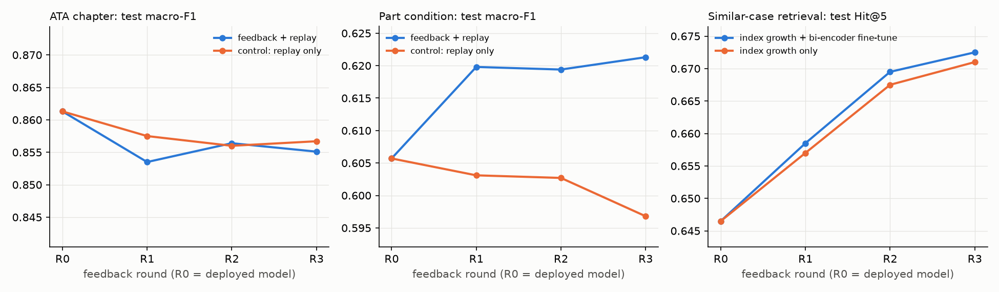

# Feedback learning loop (Phase 9)

Generated by `python -m aerofix.feedback.simulate`. Simulated deployment: models trained on <= 2023; technician feedback arrives quarterly in 2024 (R1 Jan-Mar, R2 Apr-Jun, R3 Jul-Sep) and is written to and read back from the SQLite feedback store. Measured on 2,000 fixed 2025 test reports (reporting only). The control receives the same number of training steps on old (<= 2023) data, so the gap between the two classifier lines is the value of the 2024 feedback itself.

| round | feedback_rows | index_size | clf_feedback_macroF1 | clf_control_macroF1 | clf_feedback_acc | cond_feedback_macroF1 | cond_control_macroF1 | ret_growth_Hit@5 | ret_growth_finetune_Hit@5 | ret_growth_NDCG@5 | ret_growth_finetune_NDCG@5 |
|---|---|---|---|---|---|---|---|---|---|---|---|
| 0 | 0 | 472547 | 0.8613 | 0.8613 | 0.9265 | 0.6057 | 0.6057 | 0.6465 | 0.6465 | 0.6241 | 0.6241 |
| 1 | 8409 | 480956 | 0.8535 | 0.8575 | 0.922 | 0.6198 | 0.6031 | 0.657 | 0.6585 | 0.6293 | 0.6242 |
| 2 | 16848 | 489395 | 0.8564 | 0.856 | 0.9245 | 0.6194 | 0.6027 | 0.6675 | 0.6695 | 0.6331 | 0.6307 |
| 3 | 25792 | 498339 | 0.8551 | 0.8567 | 0.9275 | 0.6213 | 0.5968 | 0.671 | 0.6725 | 0.6348 | 0.6333 |

## After 3 rounds

- **Part condition:** feedback +0.0245 macro-F1 vs the control (+0.0156 vs the deployed model). Condition codes drift between years (Phase 4: OTHER grows from 15% of train to 24% of test), and only the feedback carries the newer usage.
- **ATA chapter:** feedback -0.0016 vs the control: no measurable effect. The chapter classifier is already at ~0.86 and chapter labels do not drift, so extra recent examples add little; both updated models move by < 1 point (noise level for 2,000 queries).
- **Retrieval Hit@5:** +0.0245 from adding the feedback reports to the index alone; fine-tuning the bi-encoder on feedback triples adds +0.0015. Most of the benefit of feedback for retrieval is simply having recent, similar cases to find.
